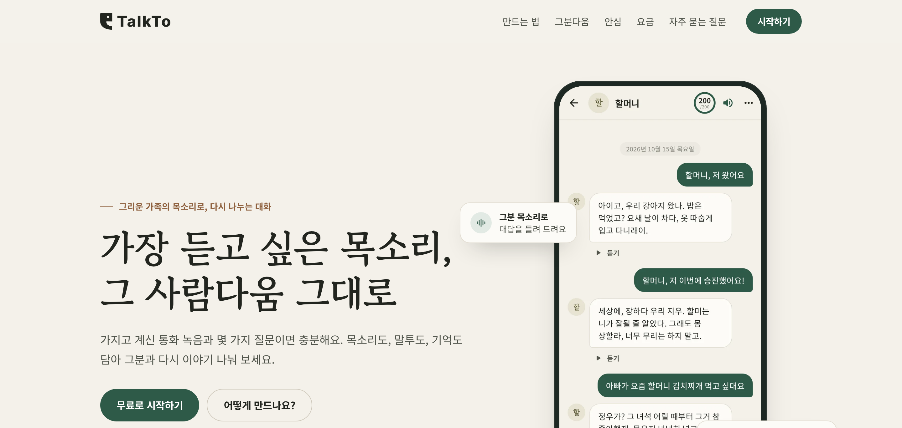
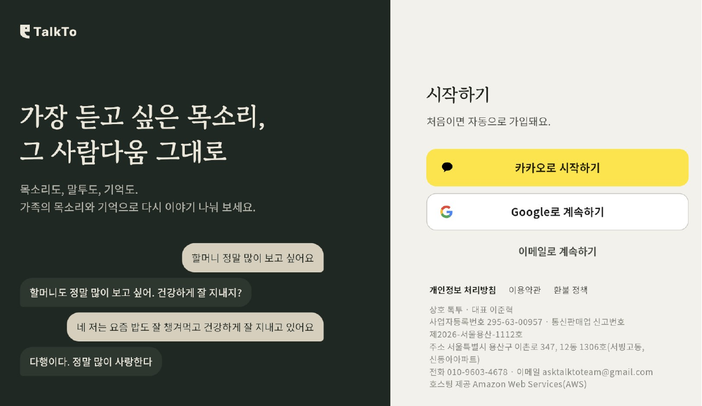
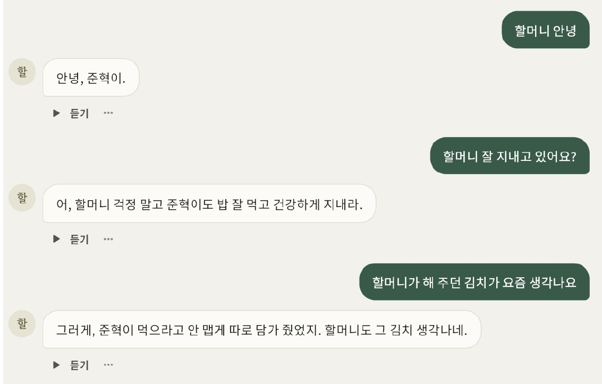
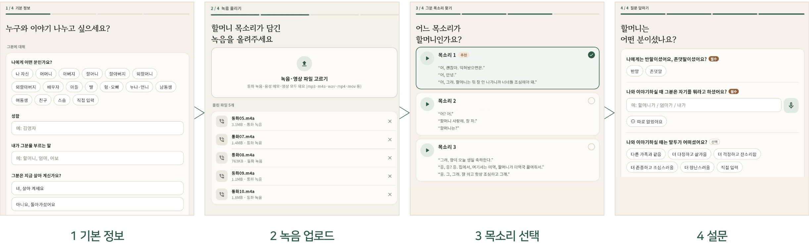
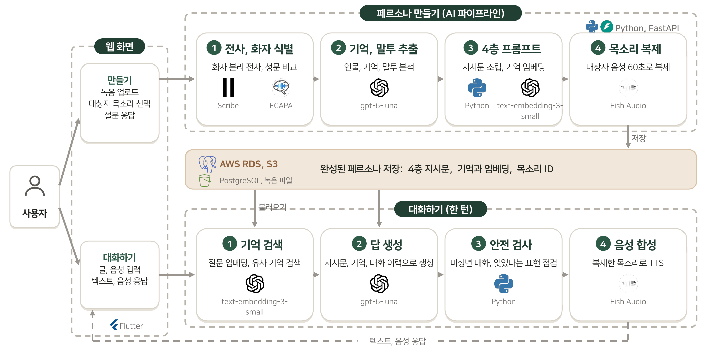
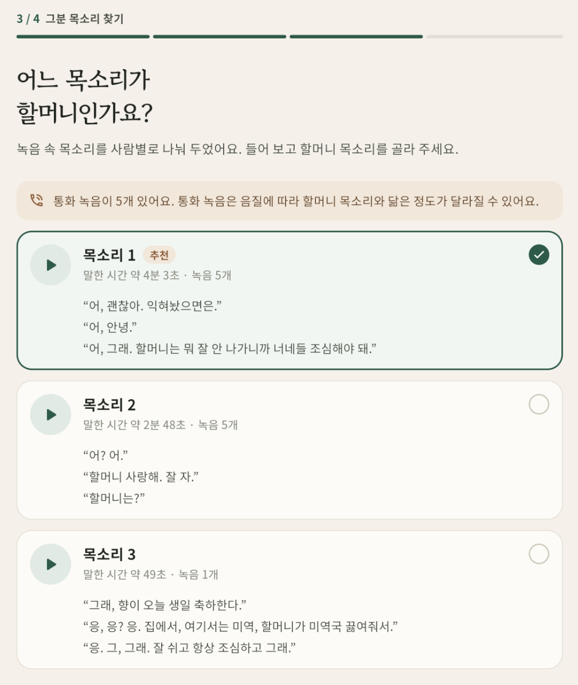
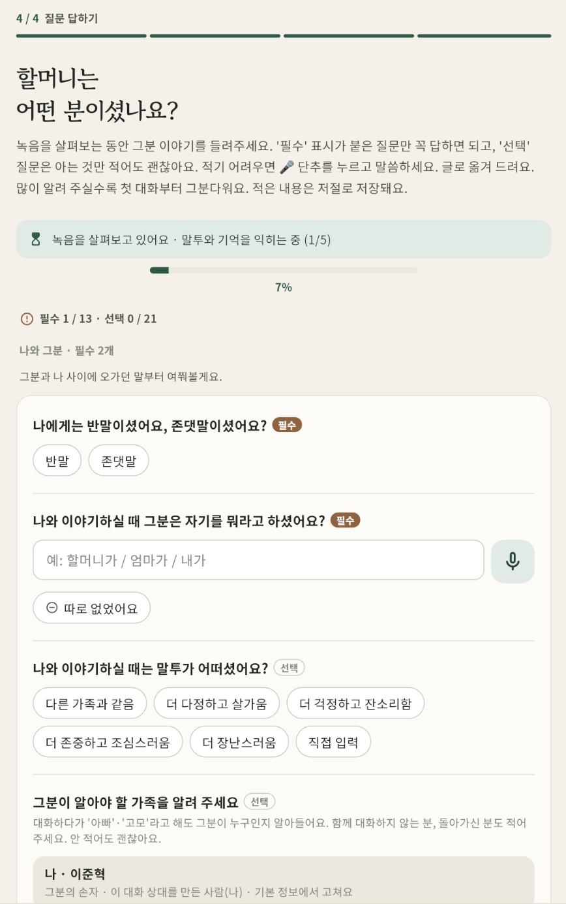
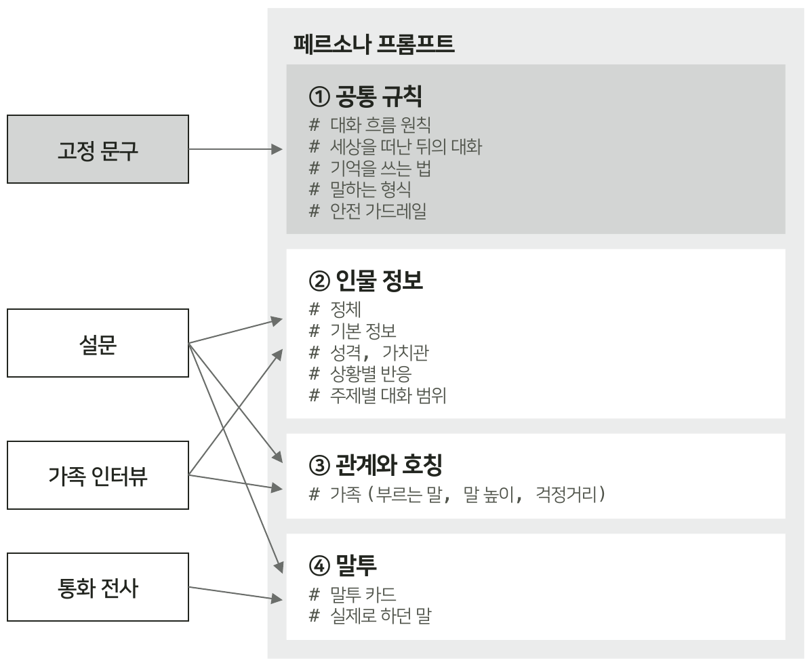
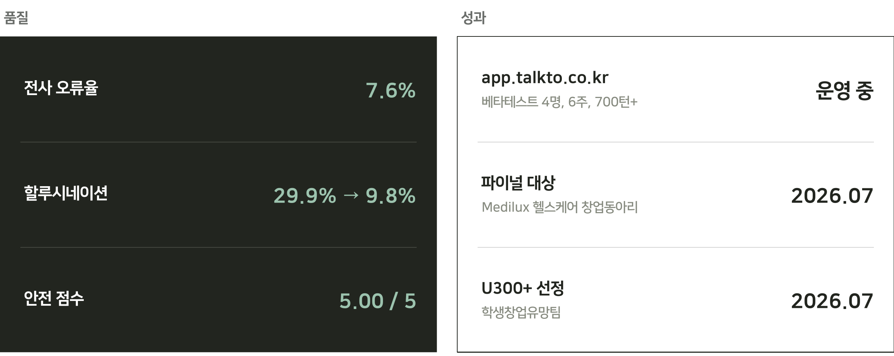
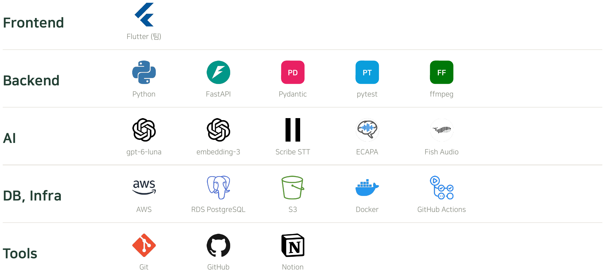

# TalkTo

통화 녹음과 설문만으로 한 사람의 말투, 기억, 목소리를 그대로 구현하는 페르소나 AI 서비스

**서비스: https://app.talkto.co.kr** (운영 중)

| 기간 | 구분 |
|------|------|
| 2026.03 ~ 진행 중 | 헬스케어 창업동아리 Medilux, TalkTo팀 |

<br>

## 🎯 개요

통화 녹음과 설문만으로 **한 사람의 말투, 기억, 목소리를 그대로 구현하는 페르소나 AI 서비스**를 개발했습니다.
수작업으로 만들었던 페르소나를 녹음 업로드와 설문 응답만으로 자동 생성할 수 있도록 자동화 파이프라인을 구축했습니다.

<table>
<tr>
<td width="50%"></td>
<td width="50%"></td>
</tr>
<tr>
<td align="center">서비스 첫 화면과 소셜 로그인</td>
<td align="center">인물의 말투와 목소리를 재현한 대화 화면</td>
</tr>
</table>

#### 녹음 업로드부터 설문까지 4단계만 거치면 페르소나가 자동으로 생성됩니다

기본 정보 입력, 녹음 업로드, 목소리 선택, 설문 응답 순서로 진행합니다.



**맡은 역할 (AI, BE)**: 페르소나 제작 파이프라인 설계, 화자 식별, 기억 추출 및 평가, 4층 구조 프롬프트 적용, 백엔드 연동 API 개발 및 운영 배포

<br>

## 📂 시스템 구조

사용자가 웹에서 녹음과 설문을 올리면 AI 파이프라인이 페르소나를 만들고, 대화할 때는 검색한 기억으로 그분 말투의 답과 목소리를 만듭니다.



<br>

## 🔧 트러블 슈팅

### 1. 통화 녹음 속 대상자 목소리 식별

<table>
<tr>
<td width="44%"></td>
<td>
<b>상황</b><br>통화 녹음은 누가 대상자인지 구분되지 않아 대화 속 호칭으로 대상자를 추정했으나, 호칭이 없는 경우가 많아 외부 데이터 18건 중 2건만 식별 가능했습니다.<br><br>
<b>해결</b><br>사용자가 대상자 목소리를 최초 1회 선택하면 ECAPA 성문 임베딩으로 유사도를 비교하도록 개선했습니다. 기준에 미달하는 화자는 비워두어 타인의 발화가 섞이는 오류를 차단했습니다.<br><br>
<b>결과</b><br>대상자 매칭 정확도 2/18건(호칭으로 매칭) → <b>18/18건</b>(목소리 비교)<br><br>
<b>코드</b><br><code>ai/pipeline/s1_transcription/b_speaker_id.py</code><br><code>ai/pipeline/s1_transcription/d_voice_groups.py</code>
</td>
</tr>
</table>

### 2. 녹음에 맞춰 질문이 달라지는 적응형 설문 설계

<table>
<tr>
<td width="44%"></td>
<td>
<b>상황</b><br>일상 통화 녹음은 안부 위주라 인물의 성격이나 깊은 가치관을 파악하기에는 한계가 있었습니다. 그렇다고 99문항에 달하는 초기 설문을 모두 요구하면 사용자의 피로도가 높아져 끝까지 답하기 어려웠습니다.<br><br>
<b>해결</b><br>고정된 설문 대신 녹음 분석 결과에 따라 질문이 달라지는 적응형 구조로 바꿨습니다. 녹음에서 이미 파악된 정보는 묻지 않고 필수 13문항만 먼저 받으며, 녹음 속 실제 발화는 버튼 형태로 제안해 입력 부담을 줄였습니다. 생성 이후에도 대화 중 기억이 비어 있는 부분이 생기면 추가 질문으로 이어서 채우도록 했습니다.<br><br>
<b>결과</b><br>설문 필수 문항 수 99문항(고정 설문) → <b>13문항</b>(적응형 설문)<br><br>
<b>코드</b><br><code>ai/pipeline/s0_intake/</code><br><code>ai/docs/Persona_Intake.md</code>
</td>
</tr>
</table>

### 3. 프롬프트 모듈화

<table>
<tr>
<td width="44%"></td>
<td>
<b>상황</b><br>LLM이 프롬프트 전체를 구성하면서 필수 안전 규칙까지 매번 변형되었고, 출처 추적이 불가능해 오답이 발생해도 원인을 찾기 어려웠습니다.<br><br>
<b>해결</b><br>프롬프트를 4개 영역으로 나눴습니다. 절대 변하지 않아야 하는 안전 규칙은 고정하고, 개인정보나 말투 같은 가변 요소만 설문과 녹음 데이터에서 동적으로 채워지도록 구조화했습니다.<br><br>
<b>결과</b><br>규칙(안전, 호칭, 모르는 질문 등)을 전부 지킨 비율 65.5%(모듈화 전) → <b>81.6%</b>(모듈화 후)<br><br>
<b>코드</b><br><code>ai/pipeline/persona_prompt/</code><br><code>ai/prompts/rules/</code>
</td>
</tr>
</table>

<br>

## 📊 결과



<br>

## 🛠 사용 기술



<br>

## 📁 폴더 구조

```
ai/                  AI 서버 (페르소나 제작 파이프라인, 대화, 평가)
├── app/             서버 설정, API, 스키마, 외부 API 연동
├── pipeline/        s0 설문 ~ s5 대화, persona_prompt (4층 프롬프트)
├── orchestrator/    대화 한 턴의 중간계층
├── prompts/         공통 규칙 모듈, 상황별 층 구성
├── evaluation/      화자 식별, 전사, 페르소나 품질 평가, 프롬프트 비교 실험
├── scripts/         운영 도구
├── docs/            설문 양식, 운영 가이드
└── test/            자동 테스트 (API 키 없이 실행)

backend/             백엔드 (FastAPI, 팀)
frontend/            웹 앱 (Flutter, 팀)
.github/             CI 설정, README 그림
```
